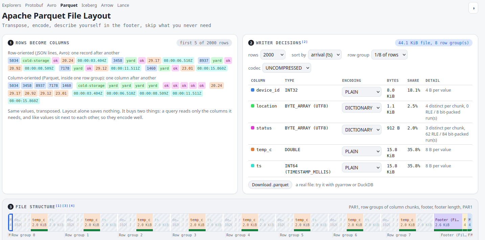
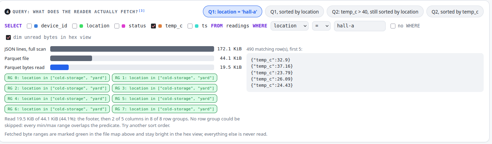
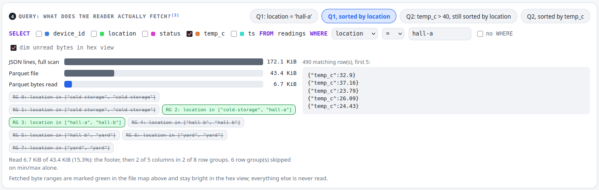

+++
date = '2026-10-21T14:56:54+02:00'
draft = false
title = 'Interactively exploring Apache Parquet files'
+++

At the start of October I gave a talk about data formats at [data2day 2026](https://www.data2day.de/veranstaltung-89225-0-vom-microservice-zum-ml-modell-eine-odyssee-durch-moderne-datenformate.html).
While preparing for that, I (or more accurately Claude) created an [interactive visualization tool](https://sweb.github.io/dataformats/)
for Protobuf, Apache Avro, Apache Parquet, Apache Iceberg, Apache Arrow and Lance - the formats I
wanted to cover in the talk. I wanted to be able to see how the actual data is
stored, which metadata sits where and how mechanics around schema evolution work. It was very
helpful to understand the different formats in detail to properly prepare the material for the
talk itself. I also showed some of the aspects live using it.

Since then, I have cleaned it up a bit and put it [online](https://github.com/sweb/dataformats).
The following walk-through of the Explorer was also used in the final talk to explain pushdown
mechanics on Parquet files.

### Projection and predicate pushdown

Apache Parquet stores statistics about the data stored in the file. These statistics can be used by
query engines like Apache Spark or Trino to limit how much of the file actually needs to be read to
answer a query. However, the way the data is sorted plays a huge role. To follow along, open the
[Parquet page](https://sweb.github.io/dataformats/parquet.html) of the Explorer. The first few
panels introduce the format (e.g. the difference between row-oriented and column-oriented as Parquet
is a column-oriented format), the file we are going to look at (how many records, which columns, how
the file is sorted) and the file structure with a binary stream viewer 
and field inspector:



We, however, are interested in the last panel that explores how much data a given query actually
fetches. It shows how many bytes need to be read to answer a query
that you can build via a couple of toggles. You also get a comparison with JSON as a baseline.
Let's select the first query scenario: The file gets filtered by `location = 'hall-a'`, leading to
the following query:

```sql
SELECT temp_c FROM readings WHERE location = 'hall-a'
```



We see that we need to read a bit less than half of the Parquet file bytes. This is due to the
fact that we only care about the temperature and the location - we do not need to look at the other
columns so we do not need to pull them into our query engine. Only fetching the data of the columns
we actually need is called projection pushdown. Underneath these bars eight green blocks are
shown. Those are the row groups (RG 0 to 7) of the Parquet file and they are green because
all of them need to be looked at. When you scroll up a bit to look at the file structure you can
see that Parquet stores the data in row groups and within each row group the data of the columns
are stored one after the other for the entire row group. Now, the mentioned statistics are
computed for each row group individually but with the rows sorted by timestamp, we see that all row
groups have the same minimum and maximum values for location in lexicographical ordering:
`cold-storage` as the minimum and `yard` as the maximum. Thus, all of them have to be fetched
to answer the query.

However, if we now change to the second version of Query 1, sorted by location, the view changes:



Only two of the eight row groups are green, the others are crossed out and the minimum and maximum
values have changed. Since we only care about `hall-a` we can ignore all row groups that have a
maximum smaller than `hall-a` or a minimum larger than that, which is called predicate pushdown.
This way, we only need to fetch 15% of the file. The Explorer allows you to dive deeper into where
this information is stored. Click on one of the row groups and it opens the file structure view with
everything expanded that leads you to the minimum and maximum value of the selected row group within
the footer.

Now always sorting by location may not be the right choice, since we may not always filter by it -
the next query filters on temperature. Sorted by location, no row group can be skipped; sorted by
temperature only two need to be fetched. This poses a problem because we need to decide at write
time how we want our files to be sorted, so we should choose a sorting that helps with most queries.
My main point here is that sorting should be an explicit consideration. It also helps with
techniques like run-length encoding that is used by Parquet - out of scope here but worth digging into
separately.

With this one example we already learned quite a bit about Parquet, like:

* Data is stored in row groups and within a row group in a column-oriented way
* The footer contains the metadata (e.g. statistics) to decide which bytes of the whole file need
to be fetched
* Parquet enables query engines to do both projection and predicate pushdown
* Row group skipping only works reliably if the data is sorted by the column you filter on

The Explorer contains a bunch of simplifications (with respect to Parquet no page index, no
bloom filters) and it does not cover the whole complexity of the available data
formats. However, it helped me a lot to get an intuition how data is stored and represented in
the different formats. I encourage you to try out the visualizations for the different formats
yourself. I also find it comforting to view the actual bytes and understand the structure behind
them. This way a Parquet file becomes more than just a binary blob that better parses correctly or
else I am doomed.

Regarding the talk: I gave myself a bit of an impossible task to cover six different formats in 40
minutes but it worked out. Check out the [slides](https://github.com/sweb/dataformats/blob/main/data2day2026.pdf)
if you are interested what came out of it and you are willing to read a bit of German.
